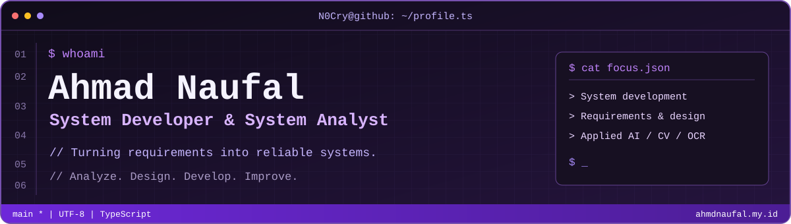

<p align="center"></p>

<p align="center">
  <a href="https://ahmdnaufal.my.id/"></a>
  <a href="mailto:ahmadnaufalsmih@gmail.com"></a>
  <a href="https://github.com/N0Cry?tab=followers"></a>
</p>

## 01 / `whoami.ts`

```ts
const naufal = {
  name: "Ahmad Naufal",
  username: "N0Cry",
  roles: ["System Developer", "System Analyst"],
  focus: [
    "Web & Mobile Development",
    "Requirement Engineering & System Design",
    "Applied AI: Computer Vision & OCR"
  ],
  portfolio: "https://ahmdnaufal.my.id/"
};
```

I build software systems that connect business requirements with practical technical solutions. My experience spans web and mobile applications, APIs, databases, system documentation, and applied computer vision research.

## 02 / `core_expertise`

| System Development | System Analysis |
| :--- | :--- |
| Web & mobile applications | Requirement engineering |
| API development & database design | Business process & workflow analysis |
| Computer vision & OCR | System design & documentation |
| Offline-first applications | BRD, FDD, TDD, EUT, UAT & user manuals |

## 03 / `tech_stack`

**Languages**

     

**Web & Mobile**

        

**Backend & Data**

    

**Applied AI & Tools**

   

## 04 / `selected_projects`

| Project | Description | Stack |
| :--- | :--- | :--- |
| Odoo Requirement Generator | Visual requirement modeling, access rights and approval workflows | React, TypeScript, Hono, Cloudflare Workers, D1 |
| N-Money | Offline-first personal finance, budgeting and local backup | React Native, Expo, SQLite |
| Timesheet Application | Clock in/out, work logs and monthly PDF/Excel reports | Next.js, Expo, Supabase |
| Inventory System | Web and mobile inventory management used at a workshop | Next.js, React Native, Supabase |
| Attendance Information System | Web-based attendance management used at LKP NAUFAL | Next.js |

Explore my [portfolio](https://ahmdnaufal.my.id/) and [public repositories](https://github.com/N0Cry?tab=repositories).

## 05 / `experience.log`

**System Development Intern** · PT Hasnur Informasi Teknologi  
November 2025 – July 2026

- Conducted YOLO and multi-model OCR research for truck license plate recognition in the Kilotrax weighbridge project.
- Developed APIs for the EBKM Plantation mobile application.
- Supported BRD, FDD, TDD, EUT, UAT and user manual preparation.

```text
Applied computer vision
Image --> YOLO detection --> Multi-model OCR --> Plate text
```

## 06 / `github_activity`

<p align="center">
  
  
</p>
<p align="center">
  
</p>

---

<p align="center"><code>analyze(); design(); develop(); improve();</code></p>
<p align="center"><a href="https://ahmdnaufal.my.id/">ahmdnaufal.my.id</a></p>
